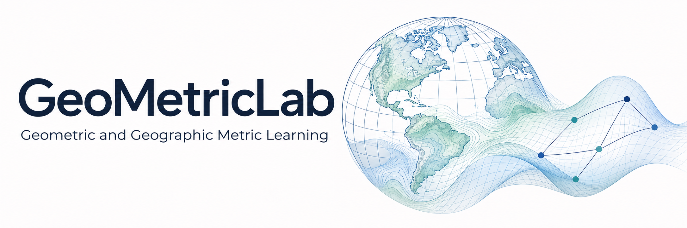
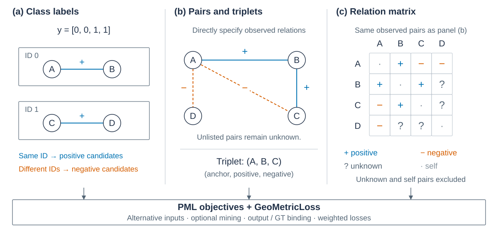
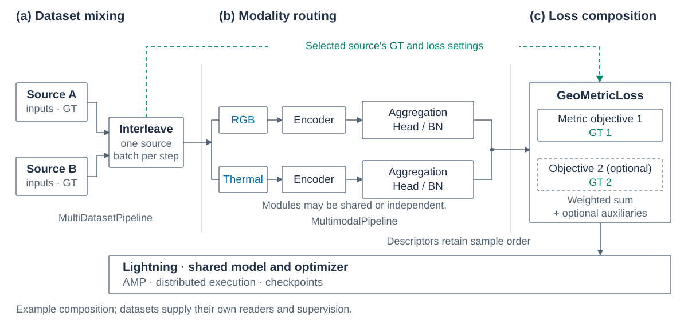

<p align="center">
  
</p>

<h1 align="center">GeoMetricLab — Geometric and Geographic Metric Learning</h1>

<p align="center">
  <a href="https://www.python.org/">
    
  </a>
  <a href="https://pytorch.org/">
    
  </a>
  <a href="https://lightning.ai/">
    
  </a>
  <a href="https://github.com/facebookresearch/dinov2">
    
  </a>
  <a href="https://github.com/KevinMusgrave/pytorch-metric-learning">
    
  </a>
</p>

<p align="center"><strong>Metric learning for visual geo-localization, place recognition and image retrieval</strong></p>

GeoMetricLab is a metric learning framework built on PyTorch, PyTorch Metric
Learning and Lightning. It separates datasets, supervision, models and objectives
so experiments can change these components while reusing the training,
evaluation and retrieval workflow.

## Supervision beyond class IDs

Class IDs describe similarity through group membership. Pairs and triplets let
you specify relationships directly, without assigning every sample to a class.
Relation matrices can describe an entire set of positive, negative and unknown
pairs. GeoMetricLab supports all of these forms through shared PML objective
execution.



A–B and B–C can both be positive while A–C is negative. This cannot be represented
by class membership alone. Unobserved pairs can remain unknown and are excluded
from the objective. The dataset defines which relations are observed.

Use native `labels`, an explicit PML `indices_tuple`, or prepared relation masks.
Independent GT and model outputs can also be assigned to separate loss terms.
See the [Python examples](gmlab/README.md#supervision) and
[relation training guide](config/gmlab/relation/README.md).

## Compose datasets, modalities and objectives

Start with one dataset and encoder, then combine multimodal branches, multiple
objectives and joint training as needed. Branches can share or separate their
backbone, aggregation, head, BN and postprocessing. Each data source keeps its
own loader, supervision and loss configuration.



Each pipeline validates component interfaces before training; its
[base configuration](config/gmlab/README.md) lists the required fields.
Use YAML inheritance for standard experiments or Python components for custom
readers, models and losses.

## Online and cached retrieval

Evaluation and extraction use the same model-input and descriptor selection.
Descriptors from a live model or a verified cache feed the same search and
reranking APIs, returning ranked results for evaluation or downstream use.
See [retrieval and reranking](gmlab/RETRIEVAL.md) for both paths.

## Installation

```bash
git clone https://github.com/Suxilan/GeoMetricLab.git
cd GeoMetricLab
```

Create the Conda environment for Linux/NVIDIA, including GPU FAISS:

```bash
make conda-env
conda activate GeoMetricLab
make check-env
```

Or install into an existing Python environment:

```bash
python -m pip install -r requirements.txt
```

The pip command installs `gmlab` in editable mode with the training dependencies.
GPU FAISS is included in the Conda environment; pip users can use Torch retrieval.
See [installation details](gmlab/INSTALL.md) for minimal installs and environment setup.

## Quick start

Prepare [University1652](datasets/README.md#university1652), then set the paths
in [u1652_labels.yaml](config/gmlab/metric/u1652_labels.yaml).
This example trains ResNet-18 + GeM with ID supervision.

```bash
python -m gmlab.train \
  --config config/gmlab/metric/u1652_labels.yaml --print-config
python -m gmlab.train \
  --config config/gmlab/metric/u1652_labels.yaml --dev 2
python -m gmlab.train \
  --config config/gmlab/metric/u1652_labels.yaml
```

`--print-config` checks the configuration without loading data or weights.
`--dev 2` runs a short training/validation check. The full run saves results to
`runtime.run_dir`.

## Documentation

| Topic | Guide |
| --- | --- |
| Models and losses | [Python examples](gmlab/README.md) · [API](gmlab/API.md) |
| Configuration and inheritance | [Training recipes](config/gmlab/README.md) |
| Dataset setup and custom readers | [Dataset examples](datasets/README.md) |
| Multimodal models | [Configuration](config/gmlab/multimodal/README.md) |
| Multiple datasets | [Joint training](config/gmlab/joint/README.md) |
| Feature extraction and whitening | [Tools](tools/README.md) · [Scripts](scripts/README.md) |
| Retrieval and reranking | [Online and cached features](gmlab/RETRIEVAL.md) |

`gmlab/` contains the reusable library; `datasets/` contains concrete readers.
`tools/` provides CLI operations and `scripts/` contains editable experiment
examples. Data and weights go in `data/` and `weights/` and are not included.

## Acknowledgements

GeoMetricLab builds on [PyTorch](https://pytorch.org/),
[Lightning](https://github.com/Lightning-AI/pytorch-lightning),
[PyTorch Metric Learning](https://github.com/KevinMusgrave/pytorch-metric-learning)
and [FAISS](https://github.com/facebookresearch/faiss).

Thanks to [OpenVPRLab](https://github.com/openvprlab) and the authors of
[DINOv2](https://github.com/facebookresearch/dinov2),
[DINOv3](https://github.com/facebookresearch/dinov3),
[SALAD](https://github.com/serizba/salad),
[CosPlace](https://github.com/gmberton/CosPlace),
[BoQ](https://github.com/amaralibey/Bag-of-Queries) and
[CricaVPR](https://github.com/Lu-Feng/CricaVPR) for sharing their work.
Please cite the original papers of the methods used in your experiments.

## License

Original GeoMetricLab code is available under the [MIT license](LICENSE).
Bundled adaptations retain their upstream licenses, including GPLv3 and
non-commercial terms where applicable; see [NOTICE](NOTICE).
[External model repositories and weights](third_party/README.md) have separate terms.
